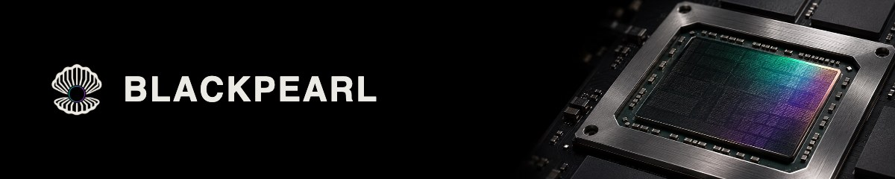

[](https://bpearl.dev/?lang=en)

**🇬🇧 English** · [🇨🇳 简体中文](README.zh-CN.md)

# BlackPearl for Linux

BlackPearl mines Pearl (PRL) on AMD Radeon GPUs. Run it from the command line or use the browser console to configure a multi-GPU rig and monitor each card by its PCIe address.

One Radeon RX 9070 XT reached a miner-reported peak of **165.57 TH/s** at a 340 W power limit.

**[Download BlackPearl 1.0.10 for Linux x86_64 (75.2 MB)](https://github.com/BlackPearlMiner/bpearl/releases/download/v1.0.10/bpearl-1.0.10-linux-x86_64.tar.gz)** · [SHA-256 checksums](https://github.com/BlackPearlMiner/bpearl/releases/download/v1.0.10/SHA256SUMS) · [Release notes](https://github.com/BlackPearlMiner/bpearl/releases/tag/v1.0.10)

## Performance

In a five-minute retest, the card averaged 165.35 TH/s and 339.52 W of board power over 270.66 seconds of steady operation. The pool accepted 7 shares, with 0 rejected, 0 stale and 0 local verification errors.

| RX 9070 XT measurement | Power limit per GPU | Hashrate |
| --- | ---: | ---: |
| Sum of four peaks measured separately (165.57 + 164.09 + 162.48 + 164.58 TH/s) | 340 W | 656.72 TH/s |
| Four GPUs running together, 950 W combined board power | 238 W | 561.82 TH/s |

An earlier single-card run at a 238 W limit peaked at 143.54 TH/s and averaged 143.44 TH/s over 58.2 seconds. [B85 benchmarks and power profiles](https://bpearl.dev/?lang=en#performance)

## Install and configure

Version 1.0.10 supports legacy Pearl mining on Ubuntu 24.04 x86_64. The RX 9070 XT requires kernel 6.13 or later, the amdgpu driver and matching firmware. The archive includes the HIP runtime.

Save the archive and checksum file in the same directory, then run:

```sh
sha256sum -c SHA256SUMS &&
  tar xzf bpearl-1.0.10-linux-x86_64.tar.gz &&
  cd bpearl-1.0.10 &&
  sudo ./install.sh
```

Open the address printed by the installer (default `http://127.0.0.1:4088`). Select the GPUs, enter your pool and payout wallet, then check board power, fan speed and temperatures in the console. The developer fee is 0.9% of mining time. The project owner wallet is exempt.

[Installation guide](https://bpearl.dev/en/guide/) · [Download center](https://bpearl.dev/en/downloads/) · [All releases](https://github.com/BlackPearlMiner/bpearl/releases)

## Report an issue

[Open a GitHub issue](https://github.com/BlackPearlMiner/bpearl/issues/new) for installation, GPU detection or mining problems. Include the BlackPearl version, Ubuntu and kernel versions, GPU model and a short log excerpt with credentials removed. [Browse existing issues](https://github.com/BlackPearlMiner/bpearl/issues).
