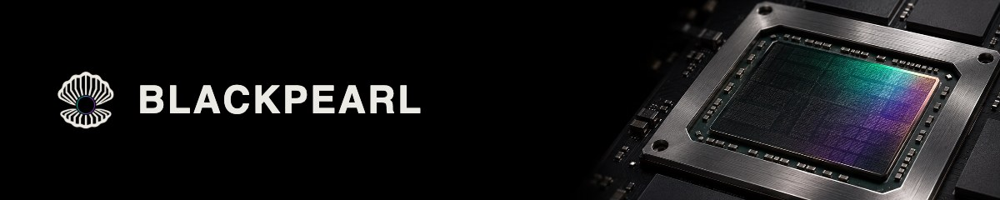

[](https://bpearl.dev/?lang=zh)

[🇬🇧 English](README.md) · **🇨🇳 简体中文**

# BlackPearl Linux 版

BlackPearl 是用于 AMD Radeon 显卡的 Pearl（PRL）挖矿软件。支持命令行启动，也可通过浏览器控制台配置多卡主机，按 PCIe 地址查看每张显卡的运行状态。

**Radeon RX 9070 XT 单卡实测峰值为 143.54 TH/s**，功率上限为 238 W。另一组四卡测试采用相同的单卡功率上限，四张卡同时运行时的**合计算力为 561.82 TH/s**。

**[下载 BlackPearl 1.0.10 Linux x86_64 安装包（75.2 MB）](https://github.com/BlackPearlMiner/bpearl/releases/download/v1.0.10/bpearl-1.0.10-linux-x86_64.tar.gz)** · [SHA-256 校验文件](https://github.com/BlackPearlMiner/bpearl/releases/download/v1.0.10/SHA256SUMS) · [版本说明](https://github.com/BlackPearlMiner/bpearl/releases/tag/v1.0.10)

## 实测性能

| RX 9070 XT 配置 | 每卡功率上限 | 实测算力 |
| --- | ---: | ---: |
| 单卡峰值读数 | 238 W | 143.54 TH/s |
| 单卡 58.2 秒平均值 | 238 W | 143.44 TH/s |
| 四卡同一时刻的读数之和 | 238 W | 561.82 TH/s |

以上数据来自 2026 年 11 月的 B85 硬件测试。四卡运行时，显卡传感器记录的板卡功耗合计为 950 W。[官网性能测试](https://bpearl.dev/?lang=zh#performance)列出了逐卡读数，以及六个功率档位下的单卡算力和能效。

## 安装与配置

1.0.10 版支持在 Ubuntu 24.04 x86_64 上运行 Pearl 传统算法（Legacy）。RX 9070 XT 需要 Linux 6.13 或更新内核、amdgpu 驱动及配套固件。安装包随附 HIP 运行库。

将安装包与校验文件保存到同一目录，执行以下命令：

```sh
sha256sum -c SHA256SUMS &&
  tar xzf bpearl-1.0.10-linux-x86_64.tar.gz &&
  cd bpearl-1.0.10 &&
  sudo ./install.sh
```

打开安装器显示的控制台地址，默认是 `http://127.0.0.1:4088`。选择显卡，填写矿池与自己的收款钱包，即可在控制台逐卡查看功耗、风扇转速和温度。普通钱包的开发费为挖矿时间的 0.9%，项目自有钱包免收开发费。

[安装手册](INSTALL.md) · [官网下载中心](https://bpearl.dev/downloads/) · [全部版本](https://github.com/BlackPearlMiner/bpearl/releases)

## 问题反馈

遇到安装、显卡识别或挖矿问题，可在 [GitHub Issues 提交问题](https://github.com/BlackPearlMiner/bpearl/issues/new)。请附上 BlackPearl 版本、Ubuntu 与内核版本、显卡型号及相关日志片段，粘贴前请移除密码等凭据。[查看已有问题](https://github.com/BlackPearlMiner/bpearl/issues)。
